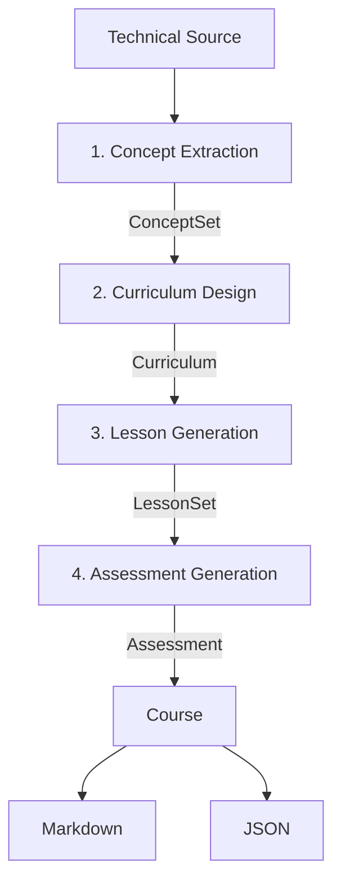

# CourseForge — Prompt Chaining with LangChain

**CourseForge transforms technical source material into an engaging micro-course through four focused LLM calls.**

It is a small, teaching-first project designed to make the **Prompt Chaining** architecture easy to see in both the code and the terminal.

The goal is not to build a full course platform. The goal is to demonstrate one LLM architecture clearly while still producing something useful and tangible.

---

## What is Prompt Chaining?

A single LLM prompt can be asked to perform a complex task from beginning to end:

```text
Source document
      ↓
"Create a complete course from this."
      ↓
Final course
```

That is simple, but it asks one model call to understand the source, decide what matters, organize it, teach it, and assess it all at once.

**Prompt Chaining** breaks that larger task into a fixed sequence of smaller, focused model calls.

```text
Input
  ↓
Prompt 1
  ↓
Structured Output 1
  ↓
Prompt 2
  ↓
Structured Output 2
  ↓
Prompt 3
  ↓
...
```

Each stage has one responsibility, and its output becomes validated input for the next stage.

The application decides the sequence in advance.

The model does **not** decide which step runs next.

That makes Prompt Chaining a **workflow pattern**, rather than an autonomous agent.

---

# CourseForge

CourseForge applies Prompt Chaining to a concrete task:

> Transform a technical source document into a structured, engaging learning experience.

The workflow contains exactly **four LLM stages**:

```text
Technical source
      │
      ▼
┌────────────────────────┐
│ 1. Concept Extraction  │
└───────────┬────────────┘
            │
        ConceptSet
            │
            ▼
┌────────────────────────┐
│ 2. Curriculum Design   │
└───────────┬────────────┘
            │
         Curriculum
            │
            ▼
┌────────────────────────┐
│ 3. Lesson Generation   │
└───────────┬────────────┘
            │
          LessonSet
            │
            ▼
┌────────────────────────┐
│ 4. Assessment          │
└───────────┬────────────┘
            │
         Assessment
            │
            ▼
      Markdown + JSON
```

Or as a Mermaid diagram:



Python controls every transition.

There is no routing, planning, tool selection, reflection loop, or autonomous decision about what happens next.

---

# The Four Stages

## 1. Concept Extraction

The first stage converts unstructured source material into a compact map of the ideas a learner actually needs.

```text
Source
  ↓
ConceptSet
```

Each concept contains:

```text
name
explanation
why_it_matters
```

The goal is not merely to summarize the source. The model identifies concepts that unlock later ideas, explain mechanisms, and contribute to the central story.

---

## 2. Curriculum Design

The second stage receives the validated `ConceptSet`.

```text
ConceptSet
    ↓
Curriculum
```

It turns those concepts into a four-module learning journey containing:

```text
course title
course hook

module
├── title
├── hook
├── objective
└── concepts
```

The curriculum is designed as a progression rather than a list of textbook chapters.

For example:

```text
How Do Satellites Measure Distance?
            ↓
How Do Distances Become a Position?
            ↓
Why Does GPS Need a Fourth Satellite?
            ↓
Why Does Einstein Matter to Your Phone?
```

---

## 3. Lesson Generation

The third stage receives both:

```text
ConceptSet + Curriculum
```

and generates one lesson for every curriculum module.

Each lesson follows the same teaching pattern:

```text
Opening Question
      ↓
Intuition
      ↓
Explanation
      ↓
Analogy
      ↓
Concrete Example
      ↓
Common Misconception
      ↓
Key Takeaways
      ↓
Challenge
```

This structure encourages the model to teach progressively rather than simply produce a long block of explanation.

---

## 4. Assessment Generation

The final LLM stage receives:

```text
Curriculum + LessonSet
```

and generates:

- 6 multiple-choice questions;
- explanations for the correct answers;
- 10 flashcards.

The assessment is based on the material actually taught by the previous stage.

After this point, the LLM workflow is finished.

Course assembly and file generation are ordinary deterministic Python.

---

# The Architecture in Code

The most important function in the repository is intentionally simple:

```python
def run_chain(source, model):
    concepts = extract_concepts(source, model)

    curriculum = design_curriculum(
        concepts,
        model,
    )

    lessons = generate_lessons(
        concepts,
        curriculum,
        model,
    )

    assessment = generate_assessment(
        curriculum,
        lessons,
        model,
    )

    return Course(
        concepts=concepts,
        curriculum=curriculum,
        lessons=lessons,
        assessment=assessment,
    )
```

That is the architecture.

Everything else in the repository supports these four transitions.

---

# Structured Handoffs

CourseForge does not pass arbitrary LLM text directly from one stage to another.

Every stage returns a validated **Pydantic object**:

```text
ConceptSet
    ↓
Curriculum
    ↓
LessonSet
    ↓
Assessment
```

These models act as contracts between stages.

For example:

```python
class Concept(BaseModel):
    name: str
    explanation: str
    why_it_matters: str
```

and:

```python
class Curriculum(BaseModel):
    course_title: str
    course_hook: str
    modules: list[Module]
```

This makes the data flow easier to reason about and prevents downstream prompts from depending on loosely formatted text.

---

# Where LangChain Fits

LangChain is used **inside each individual LLM stage**.

Each stage follows the same small pattern:

```text
PromptTemplate
      ↓
Chat Model + JSON Schema
      ↓
Validated Pydantic Object
```

Using LangChain Expression Language:

```python
prompt | structured_model
```

where:

```python
structured_model = model.with_structured_output(
    OutputSchema,
    method="json_schema",
    strict=True,
)
```

The overall workflow itself remains ordinary Python.

This distinction is intentional:

> **LangChain handles each model interaction. Python expresses the architecture.**

There is no need for LangGraph or a more complex orchestration framework for a fixed linear workflow like this.

---

# Why Native Structured Output?

A weaker approach would be:

```text
Prompt:
"Please return valid JSON."

        ↓

LLM produces text

        ↓

Try to parse it
```

CourseForge instead includes the expected JSON Schema in the model request itself.

```text
Prompt
   ↓
LLM + JSON Schema
   ↓
Validated Pydantic object
```

This is both more reliable and easier to understand as a stage contract.

The current implementation uses LangChain's `ChatOpenRouter` integration and configures OpenRouter to route structured-output requests only to endpoints that support the required parameters.

---

# Project Structure

```text
courseforge-prompt-chaining/
│
├── main.py
│
├── app/
│   ├── __init__.py
│   ├── chain.py
│   ├── prompts.py
│   ├── schemas.py
│   └── exporter.py
│
├── examples/
│   ├── gps.md
│   ├── mrna_vaccines.md
│   ├── crispr.md
│   ├── jet_engine.md
│   └── public_key_cryptography.md
│
├── tests/
│   └── test_chain.py
│
├── output/
│
├── Dockerfile
├── compose.yaml
├── pyproject.toml
├── .env.example
├── .gitignore
└── README.md
```

The structure is deliberately shallow.

There are no API routes, frontend, database, queue, vector store, service layer, provider factory, or unnecessary framework abstractions.

---

# Read the Code in This Order

The repository is designed to be read as teaching material.

### 1. `main.py`

Start here.

It shows the complete application-level flow:

```text
configuration
    ↓
input
    ↓
run_chain()
    ↓
export
```

### 2. `app/chain.py`

This is the most important file.

Start with:

```python
run_chain()
```

It shows the entire Prompt Chaining architecture before the individual stages are implemented below it.

### 3. `app/prompts.py`

Read the four prompts and see how each model call has a different responsibility.

### 4. `app/schemas.py`

See the typed objects passed between stages:

```text
ConceptSet → Curriculum → LessonSet → Assessment
```

### 5. `app/exporter.py`

See where the LLM workflow ends.

Markdown and JSON generation are ordinary deterministic Python.

If you understand `main.py` and `run_chain()`, you already understand the core architecture.

---

# Example Inputs

CourseForge includes five technical source primers:

| Example | Topic |
|---|---|
| `gps.md` | How GPS Works |
| `mrna_vaccines.md` | How mRNA Vaccines Work |
| `crispr.md` | How CRISPR Gene Editing Works |
| `jet_engine.md` | How a Jet Engine Produces Thrust |
| `public_key_cryptography.md` | How Public-Key Cryptography Works |

The examples are intentionally substantial enough to contain multiple connected ideas while remaining short enough to inspect manually.

The default input is:

```text
examples/gps.md
```

To use another included example, change:

```python
SOURCE_FILE = Path("examples/gps.md")
```

near the top of `main.py`.

Keeping this explicit is intentional: CourseForge is an architecture demonstration, not a CLI application.

---

# Setup

CourseForge requires:

- Python 3.12+
- an OpenRouter API key
- `uv`

Create an OpenRouter account and obtain an API key.

Then clone the repository and create your environment file:

```bash
cp .env.example .env
```

Configure:

```dotenv
LLM_API_KEY=sk-or-v1-your-key
LLM_MODEL=openrouter/free
```

The environment-variable names are intentionally provider-neutral.

The current implementation uses OpenRouter internally, but the application conceptually depends only on an LLM key and model.

For more repeatable demonstrations, replace `openrouter/free` with a specific compatible model.

---

# Run with `uv`

Install dependencies:

```bash
uv sync
```

Run CourseForge:

```bash
uv run python main.py
```

You should see the architecture execute directly in the terminal:

```text
[1/4] Concept Extraction
      source → ConceptSet
      ✓ 8 concepts

               ↓ ConceptSet

[2/4] Curriculum Design
      ConceptSet → Curriculum
      ✓ 4 modules

               ↓ Curriculum

[3/4] Lesson Generation
      ConceptSet + Curriculum → LessonSet
      ✓ 4 lessons

               ↓ LessonSet

[4/4] Assessment Generation
      Curriculum + LessonSet → Assessment
      ✓ 6 questions + 10 flashcards
```

Generated files are written to:

```text
output/course.md
output/course.json
```

---

# Run with Docker Compose

If you prefer not to install Python or project dependencies locally:

```bash
docker compose run --rm courseforge
```

Docker Compose runs the same application inside an isolated environment.

The local `output/` directory is mounted into the container:

```yaml
volumes:
  - ./output:/app/output
```

so generated files remain available on the host after the container exits.

Docker Compose is **not part of the Prompt Chaining architecture**.

Its purpose here is simply reproducible execution.

---

# Output

CourseForge creates two representations of the final `Course`.

## Markdown

```text
output/course.md
```

The Markdown course contains:

```text
Course title
Course hook
Course map

Concepts at a glance

Lesson 1
├── Opening question
├── Intuition
├── Explanation
├── Analogy
├── Example
├── Misconception
├── Key takeaways
└── Challenge

Lesson 2
...

Knowledge check

Flashcards
```

## JSON

```text
output/course.json
```

The JSON representation preserves the complete structured result for reuse by another application.

---

# Better Output Without More Architecture

CourseForge intentionally uses only four LLM calls.

It does **not** add:

```text
Reviewer
    ↓
Critic
    ↓
Rewrite
    ↓
Evaluator
```

to improve the generated material.

Those patterns belong to architectures such as **Reflection / Evaluator–Optimizer**.

Instead, CourseForge improves output quality through:

- focused prompts;
- richer schemas;
- clear responsibilities;
- structured handoffs.

This is an important design principle:

> **Better prompts and better contracts can improve output quality without increasing architectural complexity.**

---

# Tests

Install development dependencies with:

```bash
uv sync
```

Then run:

```bash
uv run pytest
```

The tests intentionally focus on the architecture rather than building a large testing hierarchy.

They verify that:

- the four stages execute in order;
- validated outputs are passed to the correct downstream stages;
- the final `Course` is assembled correctly;
- deterministic Markdown rendering includes the expected learning structure.

You can also run Ruff:

```bash
uv run ruff check .
```

Tests do not consume LLM API credits.

---

# Why This Is a Workflow, Not an Agent

CourseForge has no autonomous control-flow decisions.

The model cannot decide to:

- skip a stage;
- repeat a stage;
- call a tool;
- select another agent;
- route the request elsewhere;
- evaluate its own answer and retry;
- dynamically create a new plan.

The path is always:

```text
Concept Extraction
        ↓
Curriculum Design
        ↓
Lesson Generation
        ↓
Assessment Generation
```

That fixed control flow is exactly what makes CourseForge a clear demonstration of **Prompt Chaining**.

---

# Why the Project Is Intentionally Small

CourseForge aims for a balance between **simplicity** and **professionalism**.

Professionalism comes from:

- clear module responsibilities;
- type hints;
- Pydantic contracts;
- native structured output;
- strong prompts;
- focused tests;
- `.env` configuration;
- `uv` dependency management;
- Docker support;
- deterministic exports;
- readable documentation.

It does **not** come from unnecessary layers.

The goal is that a learner can move through the repository like this:

```text
README
   ↓
main.py
   ↓
app/chain.py
   ↓
app/prompts.py
   ↓
app/schemas.py
   ↓
run the project
   ↓
inspect output/course.md
```

and understand the entire architecture without having to reverse-engineer the application.

---

# Tech Stack

- Python 3.12+
- LangChain Core
- LangChain OpenRouter
- Pydantic v2
- python-dotenv
- uv
- Pytest
- Ruff
- Docker
- Docker Compose

---

## The Core Idea

CourseForge can ultimately be reduced to one simple idea:

```text
Complex task
    ↓
smaller focused task
    ↓
validated output
    ↓
next focused task
    ↓
validated output
    ↓
...
    ↓
final result
```

That is **Prompt Chaining**.